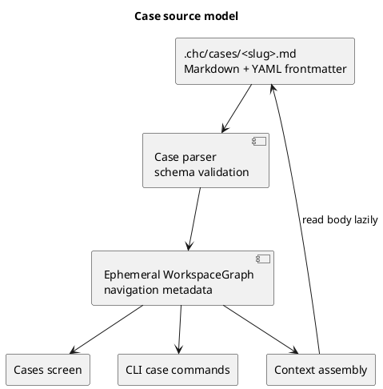
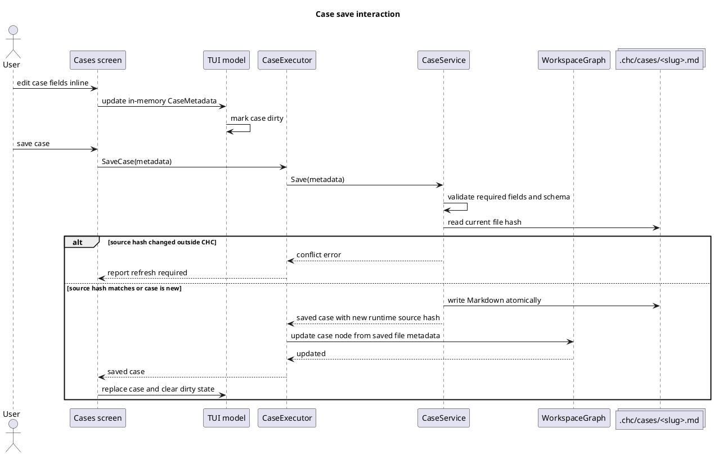
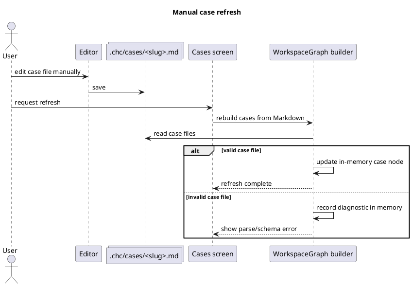
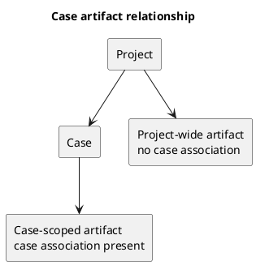

# TUI Cases Screen

Status: draft

Sources:

- `docs/explanation/tui-interactive-design-notes.md`
- `.prj/specs/specs/tui-project-tab.md`
- `.prj/specs/specs/tui-product-surface.md`

## Purpose

Define the `Cases` screen for the ChrysoCoord TUI.

The `Cases` screen is where the user lists, creates, edits, searches, and
orients work around project-local use cases. A case is a lightweight container
for related project artifacts such as dumps, quizzes, specs, plans, and board
work.

The screen must answer two questions clearly:

> Which case am I working in?

> What compact context should ChrysoCoord keep for that case?

## User Model

The primary user is one terminal/editor-oriented local operator working in one
managed project. The user may interact through the TUI, the CLI, or direct
editing of files under `.chc/`.

Manual file editing is a supported workflow. The application must preserve the
same Markdown-only model used by `Project`: human-editable Markdown files are
the source of truth, and the runtime workspace graph is an ephemeral navigation
view rebuilt from files.

## Product Rules

- The tab label is `Cases`.
- A case belongs to the current project by containment under the project's
  `.chc/` directory.
- Do not store owner fields. ChrysoCoord is a local single-user app in this
  model.
- Do not store `project_id` in case frontmatter for normal operation.
- The primary editable fields are:
  - `name`;
  - `description`;
  - long-form case context stored in the Markdown body.
- `name` is required before a new case can be saved.
- `description` is desirable but may be empty.
- Tags are not part of the first case schema. They may be reconsidered when
  there is a concrete retrieval or grouping workflow.
- Artifact counts are derived metadata, not manually edited case fields.
- Case status may exist below the UI surface when archive behavior exists, but
  the first editable surface should not add a status field without a workflow.

## Canonical Files

Cases are stored as Markdown with YAML frontmatter.

Proposed path pattern:

```text
.chc/cases/<case-slug>.md
```

The slug is stable file identity. It may be derived from the initial name, but
renaming the visible `name` should not force a file rename unless an explicit
rename workflow is implemented.

### File Format

```markdown
---
schema_version: 1
name: Blog publishing
description: Capture the authoring workflow for producing and validating blog posts.
---

Long-form case context.

This section can explain behavior, constraints, assumptions, examples, and
additional context that would make the description too long.
```

### Frontmatter Fields

`schema_version`

: Required integer. Defines the parser contract for the frontmatter schema. It
is not shown as an editable field in the TUI.

`name`

: Required string. Human-readable case name shown in the TUI and exposed in the
runtime workspace graph.

`description`

: Optional string. Compact technical case description shown in the TUI and
the runtime workspace graph.

### Markdown Body

The body is free-form Markdown.

The body carries extended case context. It is not a relational schema and should
not be parsed for structured columns.

## Persistence Model

ChrysoCoord has one durable representation of case data:

- `.chc/cases/<case-slug>.md` as the human-editable case file.

The file is the source of truth. Runtime code may build an ephemeral
`WorkspaceGraph` from Markdown files for navigation, diagnostics, and context
selection, but that graph is not persisted and is always reconstructible from
the filesystem.



## Write Model

TUI and CLI writes must go through a shared domain/application operation.

The TUI should not carry separate Markdown persistence logic. The CLI should
not carry separate persistence logic for the same behavior.

### Save Interaction



## Manual Edit And Refresh Model

Manual file edits are supported because Markdown is the source of truth.



## Runtime Staleness And Conflict Rules

No durable database staleness exists for case metadata because the Markdown file
is the durable source.

The runtime model may still track enough source information to detect external
changes while the TUI is open:

- `source_path`;
- runtime source hash;
- `mtime`;
- `schema_version`;
- parse or validation diagnostics when invalid.

Expected runtime states:

- `current`: the in-memory node reflects the last parsed file state.
- `changed`: the file changed since the active edit began.
- `invalid`: the file was read but frontmatter/schema validation failed.
- `conflict`: the app attempted to write while the file had changed outside the
  active edit.

Invalid file content must surface diagnostics and must not be treated as a valid
case definition.

## UI Layout

The `Cases` screen uses the reusable editable-screen geometry shared with
`Project`.

```text
┌────────────────────────────────────┬───────────────────────────────────────┐
│ Cases                              │ Case                                  │
│ / filter cases                     │ Name                                  │
│                                    │ [ Blog publishing                   ] │
│ > Blog publishing                  │                                       │
│   CLI validation                   │ Description                           │
│   Runtime observation              │ [ Capture the authoring workflow... ] │
│                                    │                                       │
│                                    │ Context                               │
│                                    │ [ Long-form Markdown case context    │
│                                    │   remains editable inline here. ]    │
│                                    ├───────────────────────────────────────┤
│                                    │ Artifacts                             │
│                                    │ dumps           3                     │
│                                    │ quizzes         1                     │
│                                    │ specs           2                     │
│                                    │ plans           1                     │
│                                    │ board items      4                    │
│                                    │ Source                                │
│                                    │ .chc/cases/blog-publishing.md         │
└────────────────────────────────────┴───────────────────────────────────────┘

Project  Cases  Dumps  Quizzes  Specs  Plans  Board  Dash  Help  Quit
```

Layout rules:

- left: case list, selection, and filter query;
- right top: one editable document panel containing frontmatter fields and
  long-form context;
- right bottom: derived read-only metadata and diagnostics.

Derived metadata must stay in the same visual region across `Project`, `Cases`,
and later editable artifact screens unless a concrete workflow requires a
different layout.

## Display Fields

Primary editable fields:

- `Name`;
- `Description`;
- `Context`.

Primary navigation and search fields:

- case list;
- current filter query;
- selected case marker.

Secondary read-only fields:

- source path;
- dump count;
- quiz count;
- spec count;
- plan count;
- board item count;
- index diagnostics when present.

Excluded from normal display:

- owner;
- internal generated project ID;
- `project_id` frontmatter;
- schema version as an editable field;
- artifact counts stored as editable case fields.

## Interaction Model

Initial complete interaction:

- The primary navigation opens `Cases`.
- Arrow keys move through cases in the list when list focus is active.
- `/` opens text filtering over case `name` and `description`.
- `Esc` clears filter or cancels the current edit, depending on focus.
- `Enter` on an existing case opens or focuses editable detail.
- A new-case action creates an unsaved in-memory case and moves focus to
  `Name`.
- A new case cannot be saved until `Name` is non-empty.
- Field editing happens inline where the field is displayed.
- A save action persists through the shared case service.
- A refresh action rebuilds case state from `.chc/cases/*.md`.
- If a case file changed outside the app, save shows a conflict instead of
  overwriting.
- If a case file is invalid, the screen shows an actionable diagnostic.

Exact key bindings for save, refresh, and new-case creation should be visible in
the bottom action area or contextual help before implementation.

## Artifact Relationship Rules

Artifacts may be project-wide or case-scoped.

- An artifact with no case association belongs to the project-wide set.
- An artifact associated with a case belongs to that case.
- Case artifact counts are derived from the runtime workspace graph.
- The case file must not maintain counters manually.
- An artifact referencing a missing case slug appears under unresolved case
  references. It must not silently create a new case.

Initial artifact relationship direction:



Preferred authoring progression remains:

```text
dump / quiz -> spec proposed -> spec accepted -> plan -> board
```

## Context Assembly Rules

Case metadata contributes to agent context as follows:

- `name` identifies the case compactly;
- `description` provides short technical orientation;
- body Markdown provides extended case context when the context budget allows;
- derived artifact counts are UI metadata and should not normally be sent as
  case context unless a context builder explicitly needs them.

## Bootstrap And Empty State

When no cases exist:

- the list should show an empty state, not fake rows;
- the detail region should explain that no case is selected through concise UI
  copy;
- the new-case action should create an unsaved editable case in memory;
- saving should create `.chc/cases/<slug>.md` through the shared domain service.

## Acceptance Criteria

- The screen lists existing cases.
- The user can search/filter cases by `name` and `description`.
- The user can create a new case.
- The user can edit case `name`, `description`, and long-form context inline.
- A new case cannot be saved without `name`.
- The canonical case file is Markdown with YAML frontmatter.
- Manual file edits are supported through explicit refresh.
- Invalid manual edits surface diagnostics without corrupting durable state.
- CLI and TUI writes share one domain/application operation.
- External file changes are detected before CLI/TUI writes overwrite files.
- Derived metadata appears in the lower-right region, consistent with
  `Project`.
