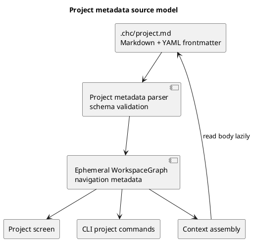
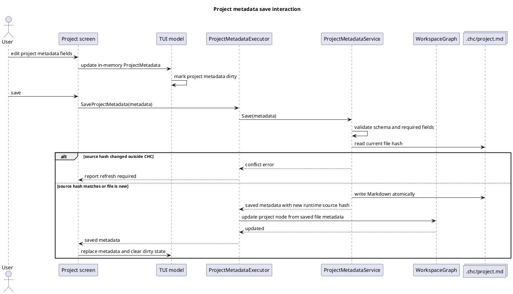
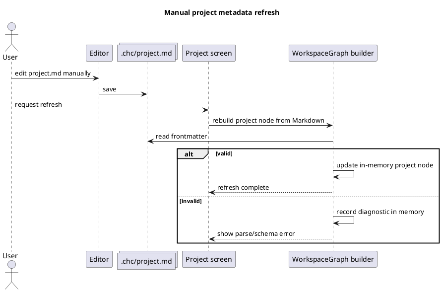

# TUI Project Tab

Status: draft

Sources:

- `docs/explanation/tui-interactive-design-notes.md`
- `.prj/specs/specs/tui-product-surface.md`
- `.prj/specs/specs/tui-navigation-and-layout.md`

## Purpose

Define the `Project` screen for the ChrysoCoord TUI.

The `Project` tab is the place where the user sees and edits the managed
project's own identity and project-level context. It is not an agent dashboard,
not an application branding surface, and not a workspace diagnostics screen.

The tab must answer one question clearly:

> What is this project, and what compact context should ChrysoCoord keep about
> it?

## User Model

The primary user is a terminal/editor-oriented local operator. They may use the
TUI, the CLI, or a text editor such as Emacs against files under `.chc/`.

Manual file editing is a first-class workflow. The application must not assume
that all changes originate from the TUI or CLI.

## Product Rules

- The tab label is `Project`.
- The visible project identity must not expose internal generated IDs such as
  `project-...`.
- The visible project identity must not use application branding as the primary
  content.
- The primary editable fields are:
  - `name`;
  - `description`;
  - long-form project context stored in the Markdown body.
- `name` is short and human-readable.
- `description` is short or medium-length and technically relevant. It should
  describe the project's main case, capabilities, or behavior.
- The Markdown body is for richer project context that would make
  `description` too long.
- Artifact counts may appear as secondary information.
- The project path may appear as secondary information.
- Workspace implementation details must not appear as normal content:
  - no `.prj` status;
  - no `.chc` status when the TUI is already running normally;
  - no labels such as `scope`, `signals`, or `local state`;
  - no tracker count until trackers have a resolved product role.

## Canonical File

Project metadata is stored as Markdown with YAML frontmatter.

Proposed path:

```text
.chc/project.md
```

The file is human-editable and belongs to the managed project workspace.

### File Format

```markdown
---
schema_version: 1
name: chc-blog-work
description: CLI/blog workspace used to validate CHC authoring flows.
---

Long-form project context.

This section can explain technical behavior, constraints, main workflows,
domain assumptions, and anything useful as extended project context.
```

### Frontmatter Fields

`schema_version`

: Required integer. Defines the parser contract for the frontmatter schema.

`name`

: Required string. Human-readable project name shown in the TUI and exposed in
the runtime workspace graph.

`description`

: Required string. Compact technical project description shown in the TUI and
exposed in the runtime workspace graph.

### Markdown Body

The body is free-form Markdown.

The body should be usable as extended project context, but it is not a
relational schema. The application may derive summaries or search material from
it, but must not depend on arbitrary body prose to populate structured columns.

## Persistence Model

ChrysoCoord has one durable representation of project data:

- `.chc/project.md` as the human-editable project file.

The file is the source of truth. Runtime code may build an ephemeral
`WorkspaceGraph` from Markdown files for navigation, diagnostics, and context
selection, but that graph is not persisted and is always reconstructible from
the filesystem.



## Write Model

TUI and CLI writes must go through a shared domain/application operation.

The TUI should not carry separate Markdown persistence logic. The CLI should
not carry separate persistence logic for the same behavior.

### Save Interaction

This diagram describes the logical interaction between UI state, application
model, domain persistence, the runtime graph, and the project metadata file. It
intentionally avoids key-level interaction details.



The service owns:

- validation;
- conflict detection;
- atomic file writes;
- runtime source hash tracking when an edit is active;
- diagnostics returned to the UI/CLI.

## Manual Edit And Refresh Model

Manual file edits are supported because Markdown is the source of truth.

The user can run an explicit refresh action. The first implementation may
expose this through the command palette or a contextual screen action. A daemon
or file watcher may be added later, but is not required for the first complete
model.



## Runtime Staleness And Conflict Rules

No durable database staleness exists for project metadata because the Markdown
file is the durable source.

The runtime model may still track enough source information to detect external
changes while the TUI is open:

- `source_path`;
- runtime source hash;
- `mtime`;
- `schema_version`;
- parse or validation diagnostics when invalid.

Expected runtime states:

- `current`: the in-memory node reflects the last parsed file state.
- `changed`: the file changed since the active edit began.
- `invalid`: the file was read but frontmatter/schema validation failed.
- `conflict`: the app attempted to write while the file had changed outside the
  active edit.

When a CLI/TUI write detects external file changes, it must not blindly
overwrite them. It should require either:

- refresh first; or
- an explicit overwrite action.

## UI Layout

The `Project` screen represents one project record. It is not a master/detail
screen because there is no project list inside the tab.

- upper area: editable project identity fields;
- lower-left: editable long-form project context;
- lower-right: derived read-only metadata and diagnostics.

The main editable panel may use `Project` as its panel title for consistency
with other primary TUI screens.

```text
┌─────────────────────────────────────────────────────────────────────────────┐
│ Project                                                                     │
│ Name                                                                        │
│ [ chc-blog-work                                                           ] │
│                                                                             │
│ Description                                                                 │
│ [ CLI/blog workspace used to validate CHC authoring flows.                ] │
├──────────────────────────────────────────────┬──────────────────────────────┤
│ Context                                      │ Artifacts                    │
│ [ Long-form Markdown project context...    ] │ tickets        12            │
│ [                                          ] │ dumps           3            │
│                                              │ quizzes         1            │
│                                              │ specs           4            │
│                                              │ plans           2            │
│                                              │                              │
│                                              │ Source                       │
│                                              │ .chc/project.md              │
└──────────────────────────────────────────────┴──────────────────────────────┘

Project  Cases  Dumps  Quizzes  Specs  Plans  Board  Dash  Help  Quit
```

Derived metadata must stay in the same visual region across `Project`, `Cases`,
and later editable artifact screens unless a concrete workflow requires a
different layout.

## Display Fields

Primary editable fields:

- `Name`;
- `Description`;
- `Context`.

Secondary read-only fields:

- project path;
- ticket count;
- dump count;
- quiz count;
- spec count;
- plan count.

Excluded from normal display:

- internal project ID;
- `.chc` existence when normal TUI startup already proves it;
- `.prj` status;
- implementation labels such as `signals`, `scope`, or `local state`;
- tracker count until the product model decides whether trackers remain
  separate from tickets.

## Interaction Model

Initial complete interaction:

- The primary navigation opens `Project`.
- Arrow keys move between editable fields when edit mode exists.
- `Enter` or an explicit edit action enters field editing.
- `Esc` cancels the current field edit.
- A save action persists through `ProjectMetadataService`.
- A refresh action reloads `.chc/project.md` into the runtime graph.
- If the file changed outside the app, save shows a conflict instead of
  overwriting.
- If the file is invalid, the tab shows an actionable diagnostic.

The exact save/refresh bindings are not finalized. They should be visible in the
bottom action area or contextual help before implementation.

## Context Assembly Rules

Project metadata contributes to agent context as follows:

- `name` identifies the project compactly;
- `description` provides short technical orientation;
- body Markdown provides extended context when the context budget allows;
- artifact counts are UI metadata and should not normally be sent as project
  context unless a context builder explicitly needs them.

The app should avoid treating README content as canonical project metadata once
`.chc/project.md` exists. README inference may be used only as bootstrap or
fallback.

## Adjacent Artifact Workflow

Project context feeds the broader authoring workflow, but the `Project` screen
does not introduce a separate draft artifact category.

Preferred artifact progression:

```text
dump / quiz -> spec proposed -> spec accepted -> plan -> board
```

Draft-like work should be represented as a specification state when it belongs
to the specification path. `Drafts` should not become a first-class project
screen or durable artifact bucket unless a separate product role is established.

## Bootstrap Rules

When `.chc/project.md` does not exist:

- the TUI may infer `name` from the project path;
- the TUI may infer `description` from the first useful README paragraph;
- inferred values should be visibly unsaved or presented as bootstrap defaults;
- saving should create `.chc/project.md` through the shared domain service.

## Acceptance Criteria

- The tab shows only project-relevant information.
- The user can identify and edit project `name`, `description`, and long-form
  context.
- The tab does not show internal generated project IDs.
- The tab does not show irrelevant workspace implementation diagnostics.
- The canonical project file is Markdown with YAML frontmatter.
- Manual file edits are supported through explicit refresh.
- Invalid manual edits surface diagnostics without corrupting durable state.
- CLI and TUI writes share one domain/application operation.
- External file changes are detected before CLI/TUI writes overwrite files.
