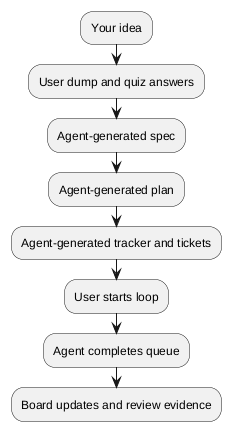

# ChrysoCoord

<p align="center">
  
</p>

[Gallery](docs/explanation/gallery.md)

ChrysoCoord is a local software-development orchestrator for agentic work.

Think of it as a controlled, Go-oriented software factory that turns rough
intent into organized implementation work, then allows agents to execute that
work ticket by ticket while leaving a reviewable trail behind.

Running `chc init` in the root of an existing Go project creates a reserved
`.chc/` workspace where ChrysoCoord stores project context, generated documents,
tickets, runtime artifacts, and execution state.

## Workflow

<div align="center">



</div>

You provide the initial intent, project context, and answers to focused
questions. The agent does the heavy work after that. It formalizes the feature,
plans the implementation, creates tickets, executes them one by one or as a
ready queue, then records what happened.

Ticket work runs through a Docker-based sandboxed runtime boundary. Execution
is explicit, inspectable, and separated from the host workflow.

## Control Surface

ChrysoCoord is operated through a TUI and mirrored CLI commands. The TUI gives
the user a project-manager view: specs, Gherkin feature files, plans, tickets,
board state, runtime activity, and review evidence. The CLI exposes the same
workflow as commands that users can script and agents can invoke when they need
to interact with the project workflow directly.

Dumps and quizzes capture context. Specs and Gherkin feature files describe the
expected behavior. Plans organize the work. Tickets are the executable unit. The
board shows what is ready, running, blocked, or waiting for review.

Once the queue is shaped, the agent can work autonomously through ready tickets.
The user can still run one ticket, run the full queue, stop the loop, inspect
the output, and review the result before promoting the work.

Review is treated as an integration checkpoint, not as a replica of human PR
review after every small slice. The review model focuses on accumulated
coherence, scope, contracts, and evidence before work is promoted. See
[Agent review model](docs/explanation/agent-review-model.md).

## Install

Build the CLI locally:

```sh
make build
```

Run it from the repository:

```sh
./bin/chc --help
```

Install it into the active Go environment:

```sh
make install
```

## First Project

Inside a project you want ChrysoCoord to manage:

```sh
chc init
chc runtime validate --dry-run
chc ticket new "Fix the failing task workflow" --type bug --priority high
chc ticket list
```

This initializes the project workspace, checks the configured runtime boundary,
creates a first ticket, and lists the tickets available to the agent.

To use the project registry:

```sh
chc project add /path/to/project
chc project select /path/to/project
chc project current
```

## Documentation

More documentation:

- [Documentation index](docs/index.md)
- [Getting started tutorial](docs/tutorials/getting-started.md)
- [User guide](docs/how-to/user-guide/index.md)
- [Observe agent work](docs/how-to/observe-agent-work.md)
- [Inspect and recover local state](docs/how-to/inspect-and-recover-local-state.md)
- [Find execution and loop evidence](docs/how-to/find-execution-and-loop-evidence.md)
- [Reference](docs/reference/project-workspace.md)
- [Explanation](docs/explanation/architecture.md)
- [Changelog](CHANGELOG.md)

## Repositories

Official repository: https://forge.adrianpk.com/adrianpk/chc

Public mirrors:

- https://codeberg.org/adrianpk/chc
