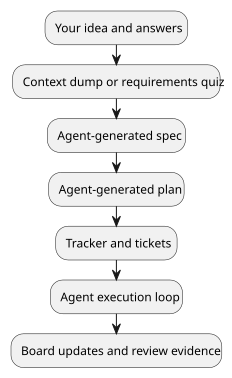

# ChrysoCoord

<p align="center">
  
</p>

ChrysoCoord is a local software-development orchestrator for agentic work.

Think of it as a controlled, Go-oriented software factory that turns rough
intent into organized implementation work, then allows agents to execute that
work ticket by ticket while leaving a reviewable trail behind.

Running `chc init` in the root of an existing Go project creates a reserved
`.chc/` workspace where ChrysoCoord stores project context, generated documents,
tickets, runtime artifacts, and execution state.

## Workflow

<div align="center">



</div>

You provide the initial intent, project context, and answers to focused
questions. The agent does the heavy work after that. It formalizes the feature,
plans the implementation, creates tickets, executes them one by one or as a
ready queue, then records what happened.

Ticket work runs through a Docker-based sandboxed runtime boundary. Execution
is explicit, inspectable, and separated from the host workflow.

## Capabilities

ChrysoCoord puts a controlled workflow around that process. Dumps preserve rough
project knowledge. Quizzes put the agent in a requirements-analysis role.
Specifications turn the captured knowledge into expected behavior. Plans and
trackers turn the spec into visible implementation work. Tickets become the
unit the agent can actually execute.

The result becomes project material. Specs, plans, tickets, comments, reports,
changed-file summaries, plus validation evidence live with the project as
editable Markdown and local artifacts.

Remote operation is part of the direction of travel. Telegram-driven
orchestration is still transport work, with the current plumbing shaped around
that model.

## Control Model

ChrysoCoord makes the work inspectable before code changes start. You can review
the spec, inspect the plan, see the tickets, run a single ticket, run the whole
queue, stop the loop, then review the board after execution.

That gives the agent room to work while keeping control points in the hands of
the user. The sandboxed runtime adds a practical safety boundary around the code
execution phase.

ChrysoCoord treats the user more like a project manager than a harness operator.
Shape the work, inspect the generated tickets, choose what runs, watch progress
on the board, then review the result. Once the queue is shaped, the agent can
work autonomously through ready tickets while ChrysoCoord keeps execution
bounded and observable.

## System Shape

ChrysoCoord currently focuses on local Go projects. It provides a CLI, a TUI, a
Docker-based runtime boundary for ticket execution, plus Markdown-first project
artifacts under `.chc/user/`.

Detailed technical material lives under `docs/`; the README is only the front
door.

## Install

Build the CLI locally:

```sh
make build
```

Run it from the repository:

```sh
./bin/chc --help
```

Install it into the active Go environment:

```sh
make install
```

## First Project

Inside a project you want ChrysoCoord to manage:

```sh
chc init
chc runtime validate --dry-run
chc ticket new "Fix the failing task workflow" --type bug --priority high
chc ticket list
```

This initializes the project workspace, checks the configured runtime boundary,
creates a first ticket, and lists the tickets available to the agent.

To use the project registry:

```sh
chc project add /path/to/project
chc project select /path/to/project
chc project current
```

## Documentation

The README is the front door. Detailed technical material lives under
`docs/`, organized with Diataxis:

- [Documentation index](docs/index.md)
- [Getting started tutorial](docs/tutorials/getting-started.md)
- [User guide](docs/how-to/user-guide/index.md)
- [Inspect and recover local state](docs/how-to/inspect-and-recover-local-state.md)
- [Find execution and loop evidence](docs/how-to/find-execution-and-loop-evidence.md)
- [Reference](docs/reference/project-workspace.md)
- [Explanation](docs/explanation/architecture.md)

Use reference pages for exact command behavior, workspace layout, configuration,
ticket schema, and runtime contracts. Use explanation pages for architecture,
runtime design, slicing, ticket lifecycle, and document-generation rationale.

## Development

Common local checks:

```sh
make fmt
make test
make verify
```

Run the CLI without installing:

```sh
make run RUN_ARGS="--help"
```
