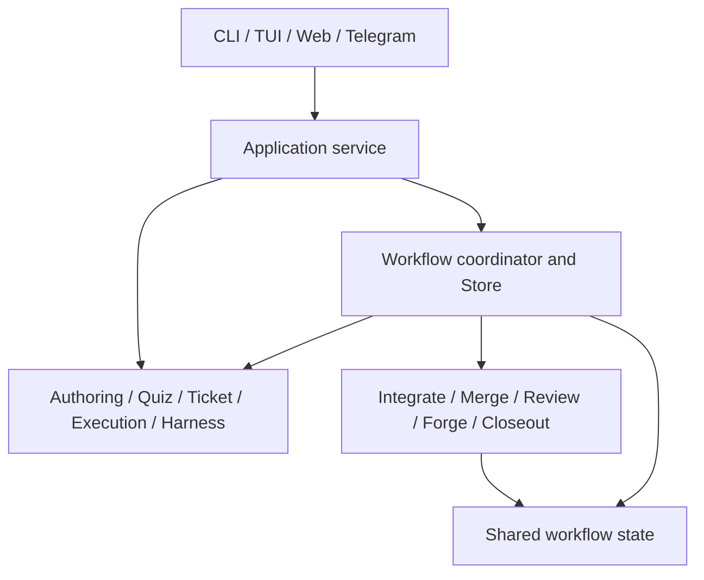

# Capability boundaries

The application service in `internal/app` is the shared operation entrypoint for
CLI, TUI, Web and Telegram. Adapters parse requests and render results; the
service composes capability owners under `internal/core`. Package names identify
ownership, while durable record names preserve the established wire contracts.

This is a composition map. The exact production imports, including generated
sources and build variants, are checked by
[the dependency policy](../../scripts/goquality/boundaries.go). Each extracted
owner has an explicit module dependency set; descendants inherit its bound.
Capabilities and stages cannot import the root coordinator or an application
adapter. Stage siblings communicate through host-composed ports rather than
importing one another.

## Capability owners

Paths below are relative to `internal/`.

| Owner | Responsibility and public entrypoints |
| --- | --- |
| [app](../../internal/app/README.md) | Shared operations, command factory, adapter composition and presentation projections. Typed dependencies replace command metadata lookup. |
| [core](../../internal/core/README.md) | Remaining composition and cross-capability operations. It provides no workflow forwarding facade. |
| [core/authoring](../../internal/core/authoring/README.md) | Sessions, dumps, specs, plans, guarded artifact changes and source revision checks. `generation`, `state` and `acceptance` retain distinct request, shared-data and acceptance artifact contracts. |
| [core/quiz](../../internal/core/quiz/README.md) | Quiz records and rules; `quiz/model` owns provider-neutral payloads, schemas and validation; `quiz/openai` owns HTTP encoding and bounded responses. |
| [core/ticket](../../internal/core/ticket/README.md) | Markdown tickets, metadata, file repositories, indexing and reconciliation. Native projections share the existing SQLite handle; cached indexes do not acquire source authority. |
| [core/execution](../../internal/core/execution/README.md) | Execution repositories, branch policy, worktree lifecycle, readiness observation and explicit safe repair. Observation does not authorize repair. |
| [core/telegram](../../internal/core/telegram/README.md) | Receiver identity/configuration, bounded intake, acknowledgement, HTTP and outbox contracts. `telegram/message` owns message representation. |
| [core/notify](../../internal/core/notify/README.md) | Notification selection, durable reservations and delivery evidence. Ambiguous acknowledgement cannot authorize blind retry. |
| [core/project](../../internal/core/project/README.md), [core/workspace](../../internal/core/workspace/README.md) | Registry and project layout. `workspace/config` owns the complete parsed configuration and guarded harness-selection changes. |
| [core/harness](../../internal/core/harness/README.md) | Selection, profiles and immutable binding identity. `host`, `runtime`, `daemon` and `trace` own host generation, runtime plans, daemon lifecycle and bounded traces. |
| [harness](../../internal/harness/README.md) | Runner interfaces and concrete Codex/Pi adapters. Provider selection does not transfer host admission, validation or mutation authority. |
| [core/gate](../../internal/core/gate/README.md) | Validation command lifecycle and report evidence. A successful command alone does not establish delivery. |
| [core/database](../../internal/core/database/README.md), [core/ops](../../internal/core/ops/README.md) | Explicit database rows/scans and operational file/namespace primitives. Owners retain locking, rollback and source-image checks. |

## Workflow operations and durable authority

[workflow](../../internal/core/workflow/README.md) owns the coordinator and
`Store`. Application callers use coordinator operations such as `ExecuteTask`,
`ReviewSlice`, `SubmitIntegration`, `ContinueWorkflow` and `CloseSet` directly.
Private hosts supervise commands, watched deadlines and bounded continuation.
`Store` retains repository exclusion, claims, current-image fences, journals,
atomic multi-record acceptance and recovery. An extracted policy cannot commit
an independently accepted partial transition.

The five stages use 22 finite, consumer-owned ports. Their implementations bind
the original private claim, prepared input, provider or journal identity. Ports
expose concrete operations and outcomes, with no Store getter, arbitrary action
callback or opaque escape capability.

| Stage | Owned behavior |
| --- | --- |
| [integrate](../../internal/core/workflow/integrate/README.md) | Candidate and preparation validation, repair admissibility and evidence acceptance. |
| [merge](../../internal/core/workflow/merge/README.md) | Merge driver/tool policy and repair/history proof. |
| [review](../../internal/core/workflow/review/README.md) | Exact input binding, admission restrictions and decisions. |
| [forge](../../internal/core/workflow/forge/README.md) | Provider requests, bounded discovery, publication policy and canonical observation classification. |
| [closeout](../../internal/core/workflow/closeout/README.md) | Actual-member closure inputs, ordered validation and unconfirmed command receipts. |

[workflow/state](../../internal/core/workflow/state/README.md) contains retained
values and spellings. Host boundaries still validate schema, checksum, revision,
authority and receipt identity. Type movement does not migrate stored records.
See the [publication and review terms](architecture.md#publication-and-review-terms)
and [workflow glossary](../reference/workflow-glossary.md).

## Presentation and performance

The TUI uses one pointer model with 17 named substates. Its ordered update and
key-hint handlers preserve dispatch precedence; asynchronous commands capture
immutable IO dependencies before leaving the event loop. Shared document
catalog and panel renderers retain per-kind actions, focus and geometry. Web
guided partials consume their own sections of the existing view image. Record
and projection grouping preserves flattened JSON, field names and SQL column
order; it does not change the corresponding wire schema.

Production signatures permit five parameters and zero/one result or `(T, error)`
or `(T, bool)`. Only the exact external Bubble Tea `Model.Update` signature is
excepted. The whole-source checker, pinned revive rules and production dupl
threshold 150 run through `make verify`; there is no migration debt allowance.
