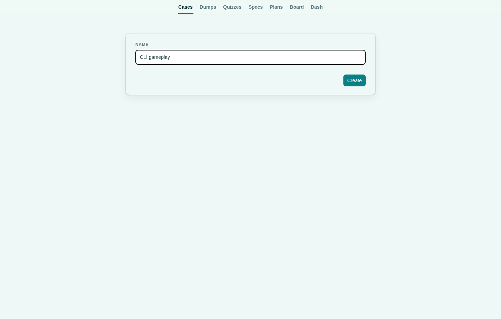
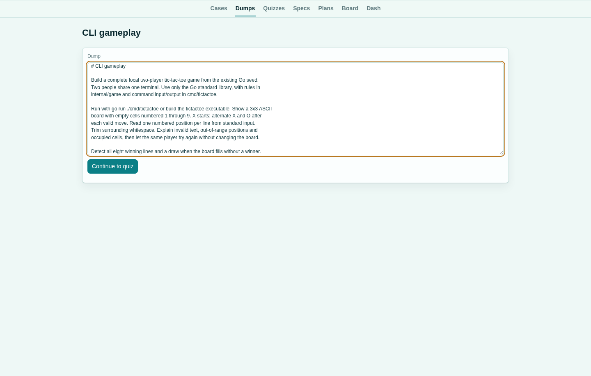
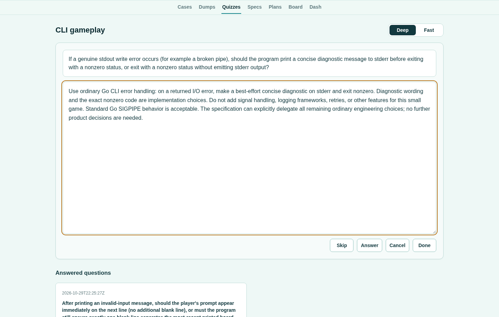
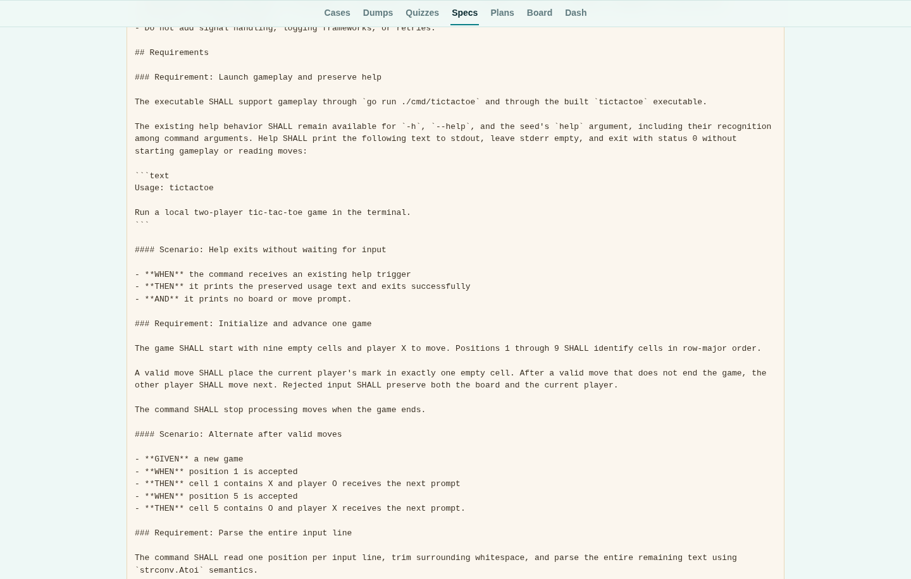
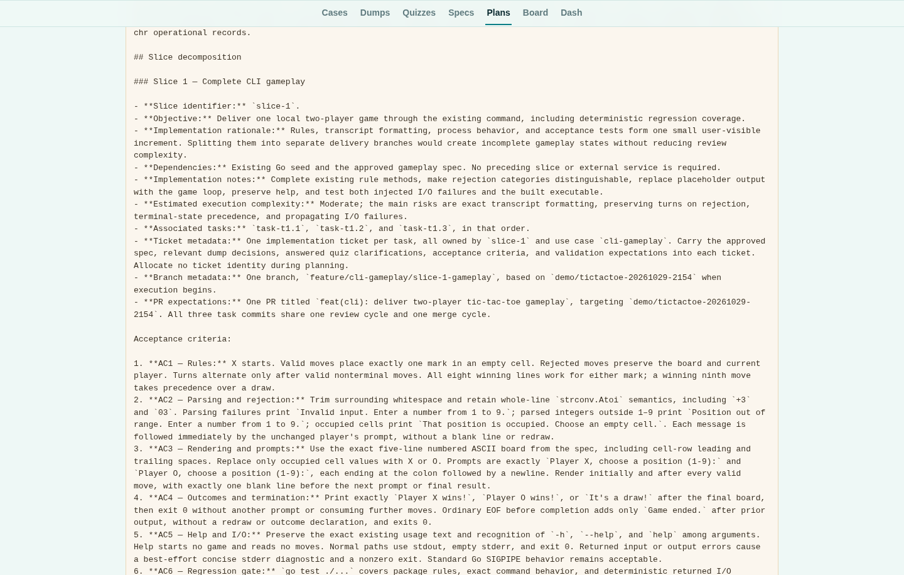
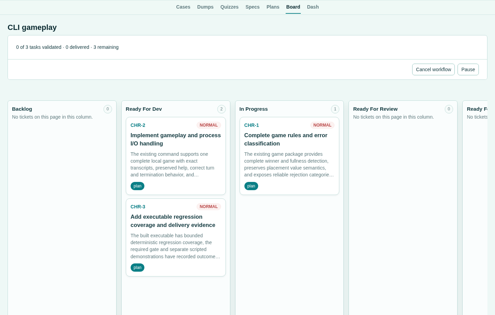
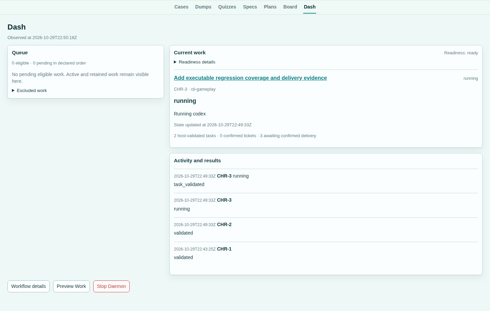
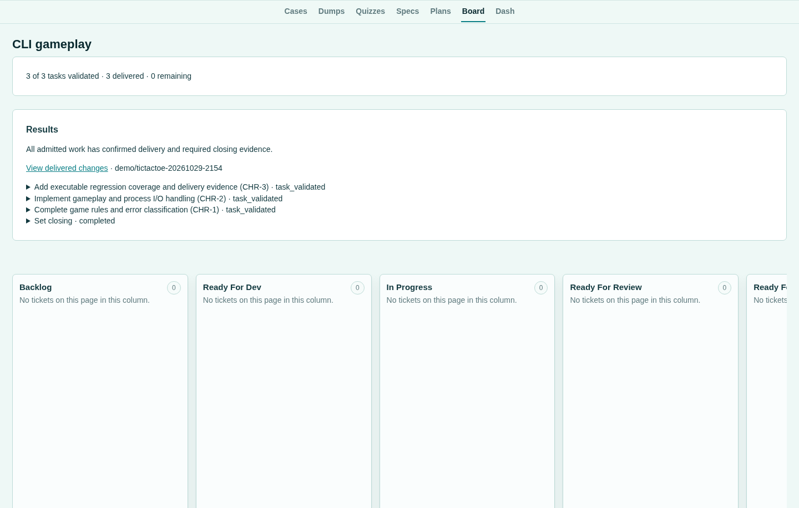
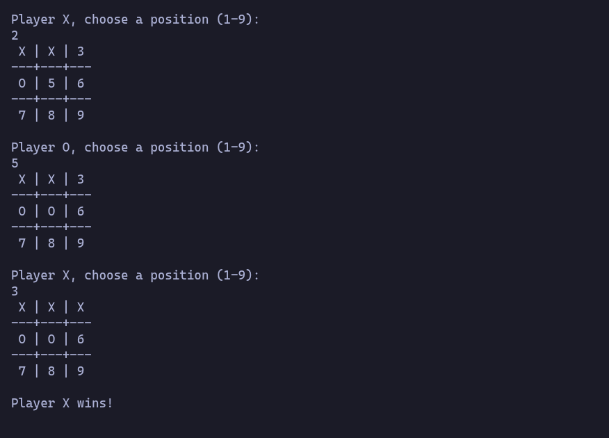

# Web gallery

Build a two-player tic-tac-toe CLI through chr's Web. This sequence follows
**CLI gameplay**, from the Wizard in Cases to the generated game. The
[TUI gallery](gallery-tui.md) follows the same example and saved work.

## Wizard

Start Wizard from Cases and give the use case a name.

## Dump

Capture the gameplay requirements in the existing Dump editor, then continue to quiz.

## Quiz

Quizzes keeps the question, answer field, mode and saved answers together.

## Specification

Inspect the generated specification and its gameplay contract.

## Plan

Inspect the implementation plan and prepared work.

## Board

Board shows the tickets belonging to this use case and their current state.

## Dash

Dash exposes execution activity.

## Results

Results distinguish validation from confirmed delivery and retain the evidence.

## The generated game

The generated command runs independently of chr. Run the
[preserved game](../../qa/showcase/tictactoe/README.md) locally, or follow the
[capture guide](../how-to/capture-showcase-galleries.md) to repeat the scenario.
