# Gallery

Visual examples of Chryso in use.

This gallery follows a seeded reference project through context, specification,
planning, board state, ticket execution, review state, and runtime proof.

## Context

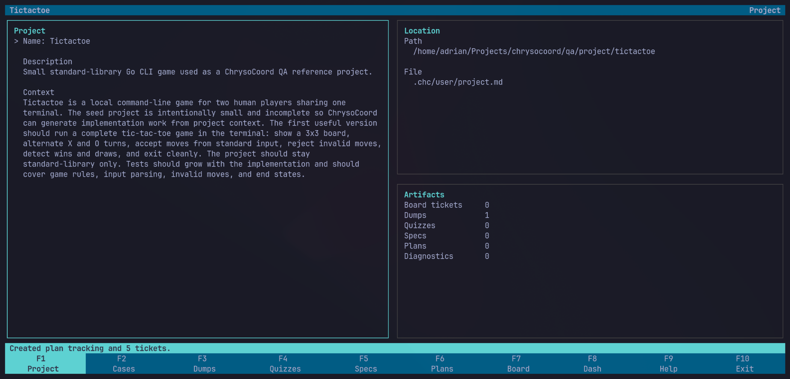

The project view keeps workspace context and generated artifacts visible.

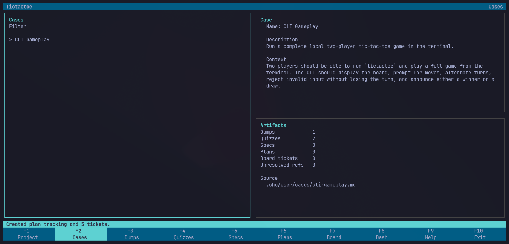

Use cases keep feature work scoped before it becomes implementation work.

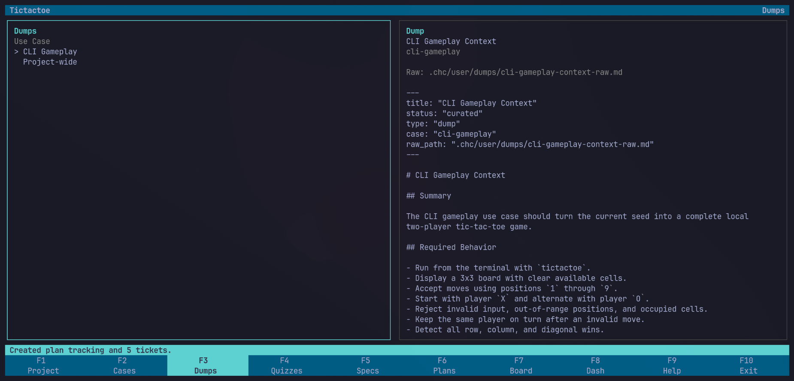

Dumps preserve rough context in natural language.

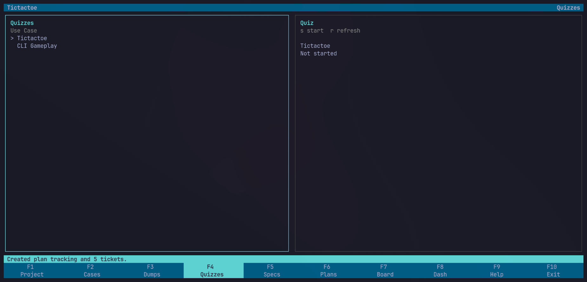

Quizzes capture focused answers without turning the user into a spec machine.

## Specification

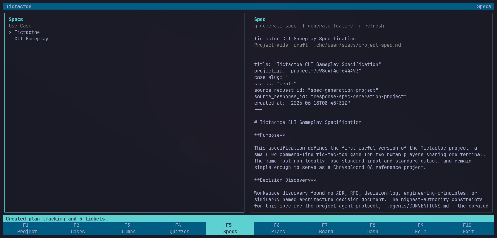

Specs turn captured context into expected behavior and acceptance boundaries.

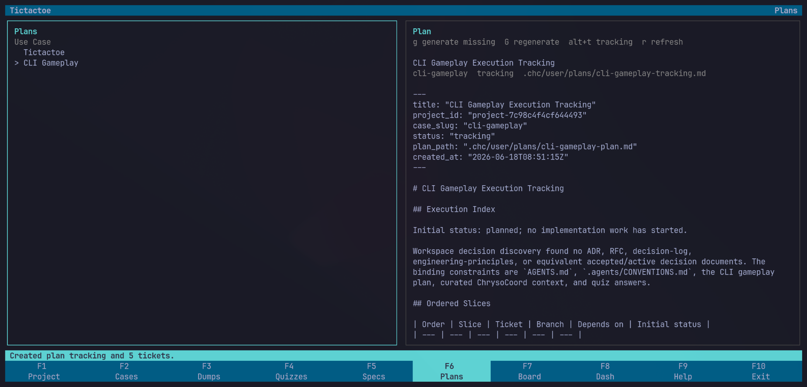

Plans slice the work into tickets that the agent loop can process.

## Board

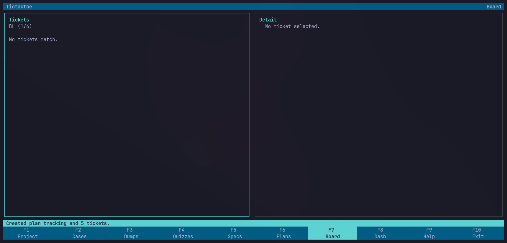

The board exposes ticket state as the implementation queue changes.

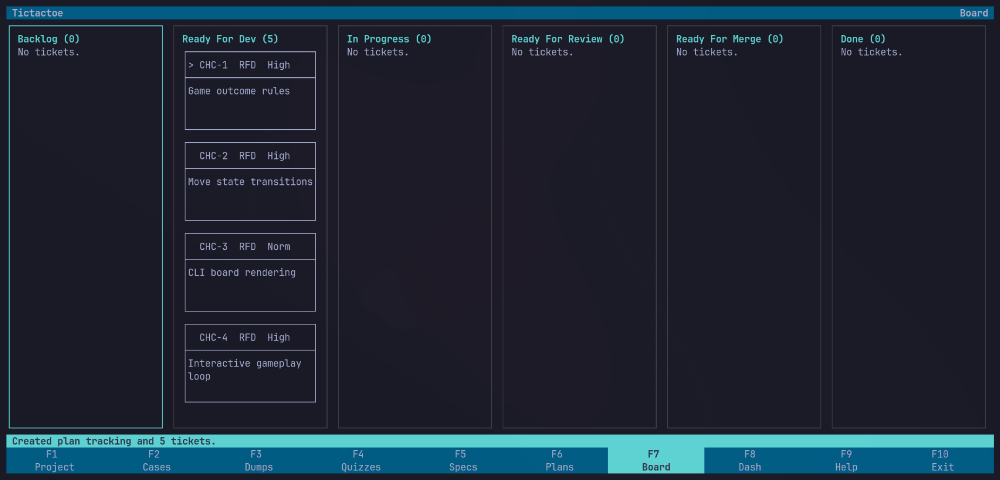

Generated tickets appear on the board once planning has produced implementable
work.

## Dash

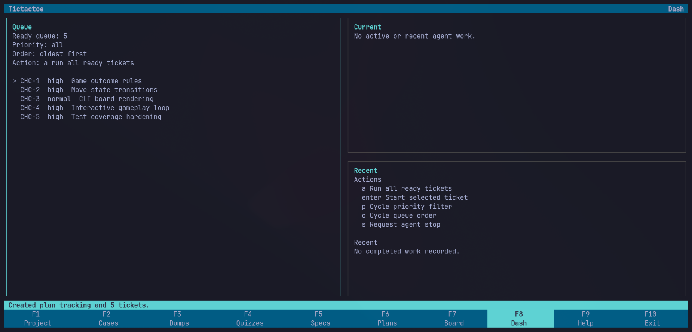

Dash shows the ready queue before execution starts.

Dash shows the queue before execution begins.

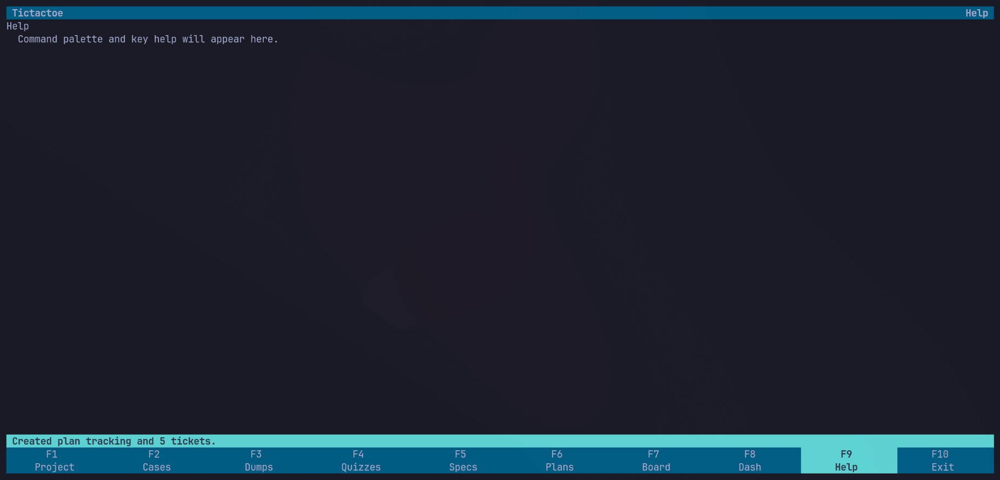

The runtime surface includes a place for operational help and hints.

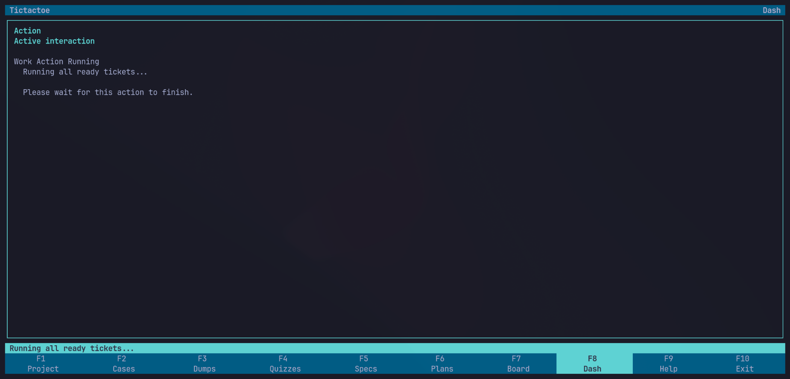

Once running, Dash reports the active task and current execution state.

The execution surface keeps progress visible during a long agent run.

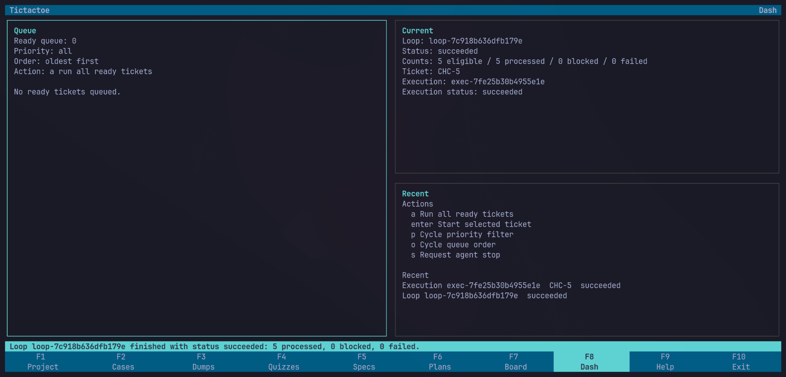

Successful completion returns the loop result to the operator.

## Review

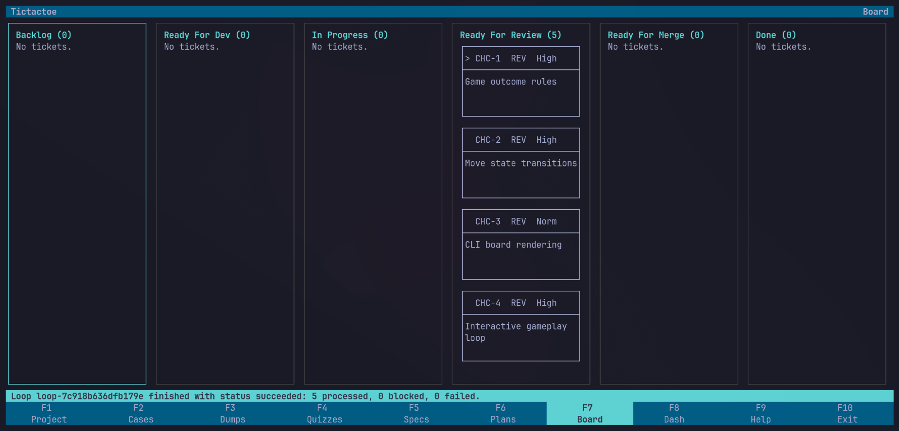

Completed work moves into review state on the board.

## Runtime Proof

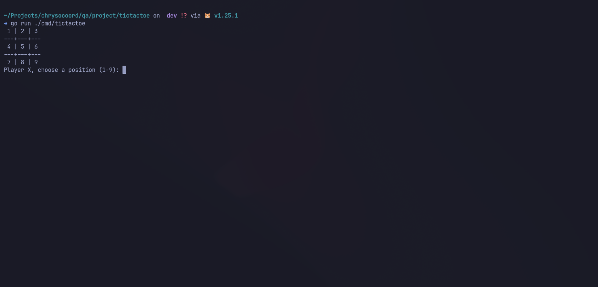

Runtime behavior provides evidence beyond a static diff.

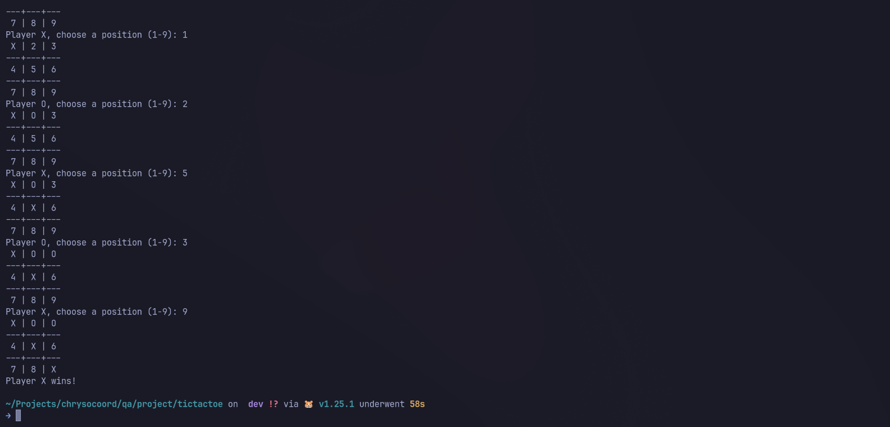

The completed reference app reaches a successful gameplay state.

## Previous Version

The earlier gallery is preserved in [Old Gallery](old-gallery.md).
