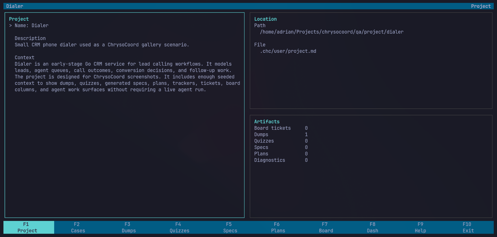
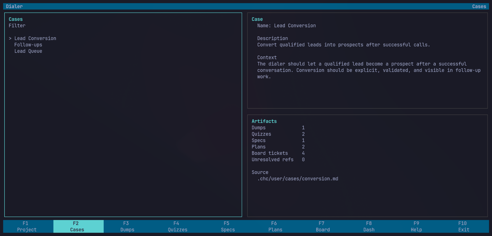
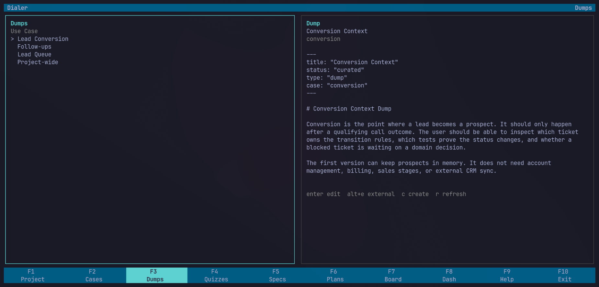
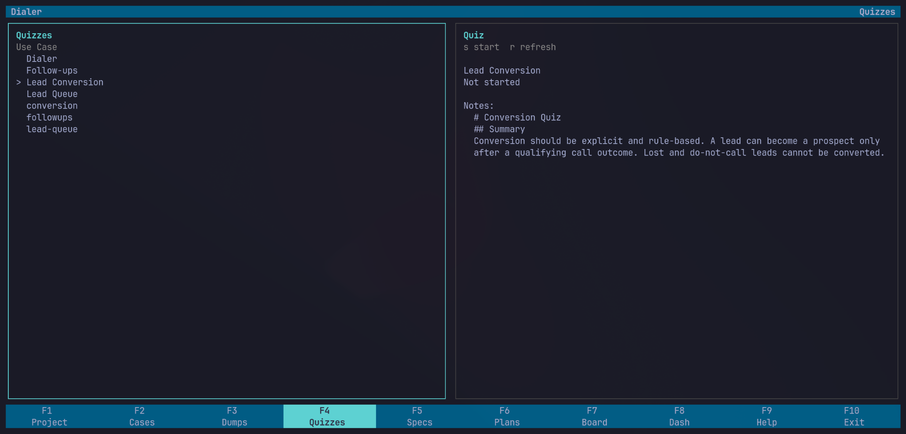
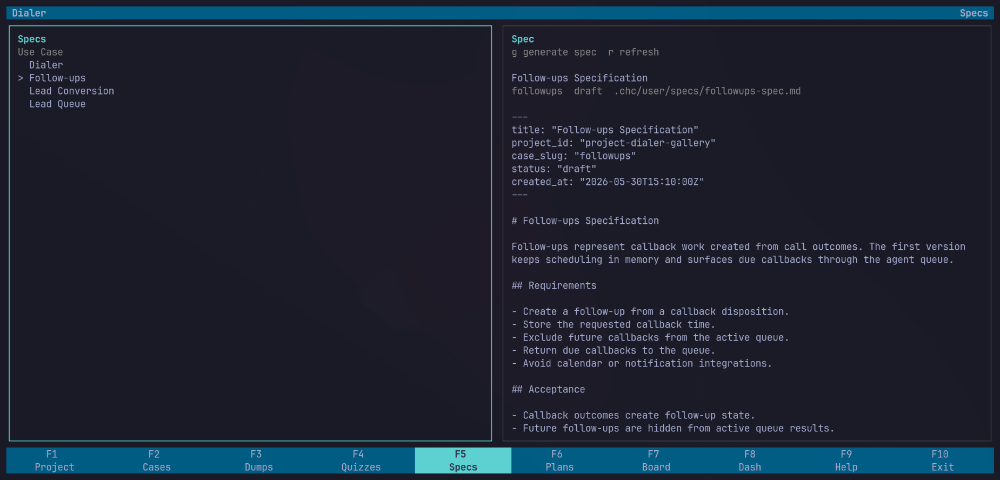
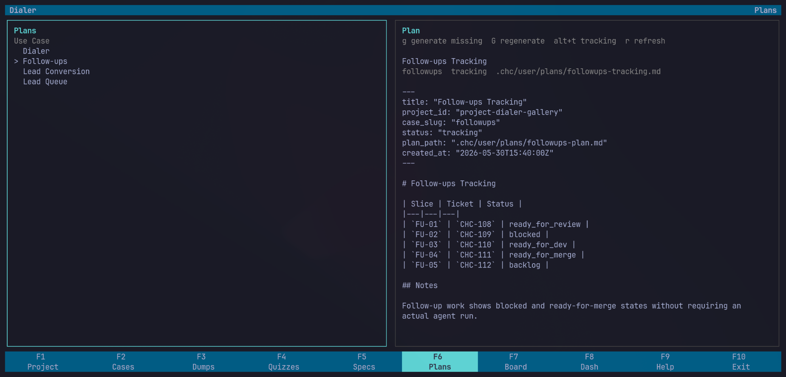
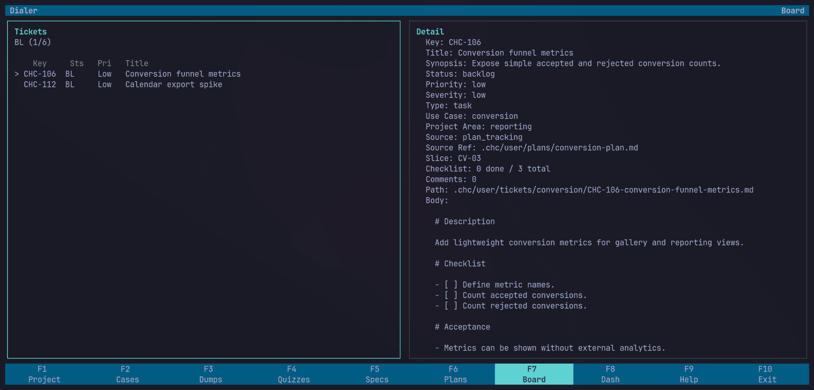
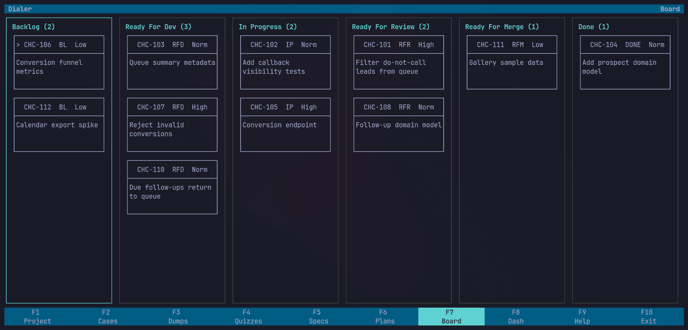
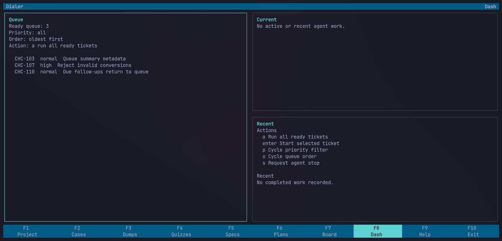

# Old Gallery

Visual examples of the earlier Chryso gallery pass.

These screenshots use a seeded CRM dialer project to show the main TUI surfaces
without requiring a live agent run.

## Project

The project view summarizes the selected workspace, local `.chr/user/` files,
and generated artifact counts.

## Use Cases

Cases group related project work and keep feature context separate from
project-wide context.

## Context Capture

Dumps preserve rough project knowledge before it becomes a formal spec.

Quizzes capture focused answers that help the agent clarify requirements.

## Generated Work

Specs turn captured context into expected behavior.

Plans and trackers turn the spec into visible implementation work.

## Board

The board detail view shows the selected ticket and its execution context.

The column view shows the implementation queue across ticket states.

## Dash

Dash is the runtime surface for agent execution and queue progress.

